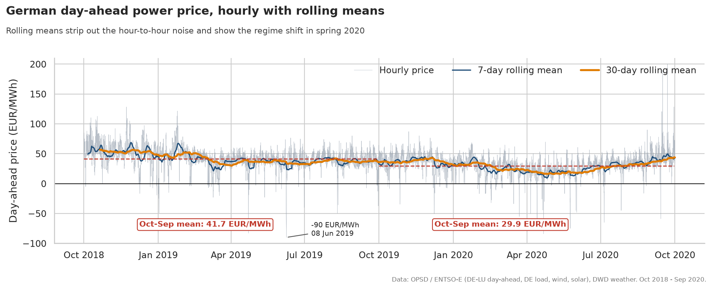
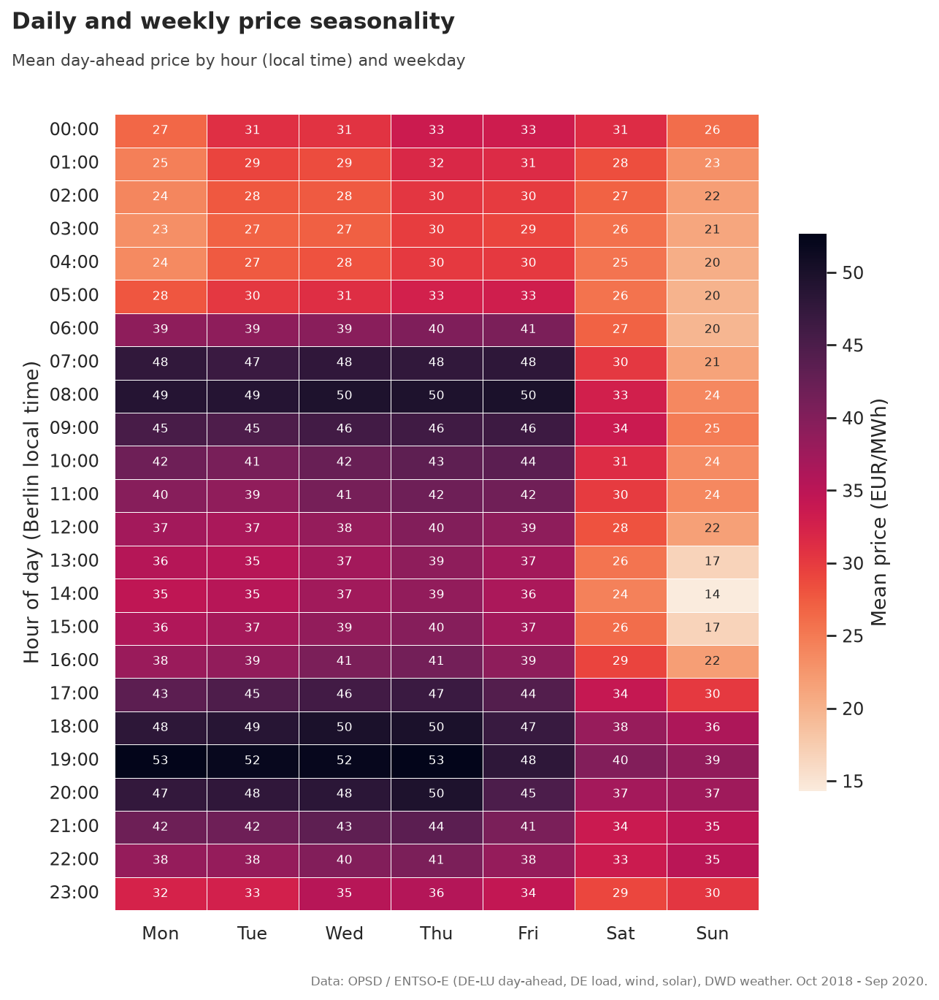
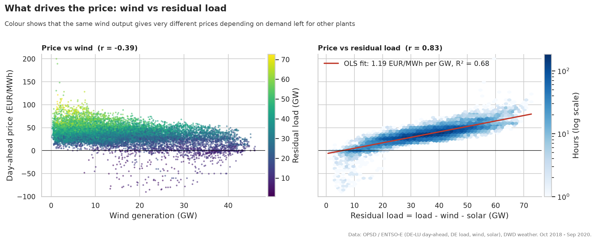
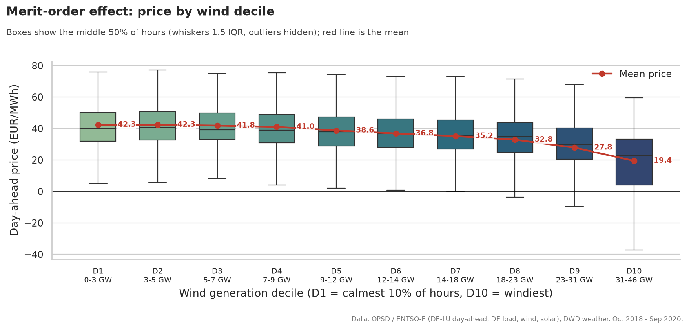
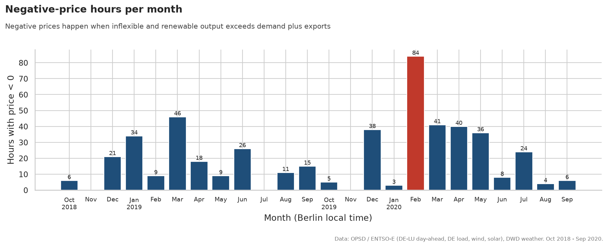
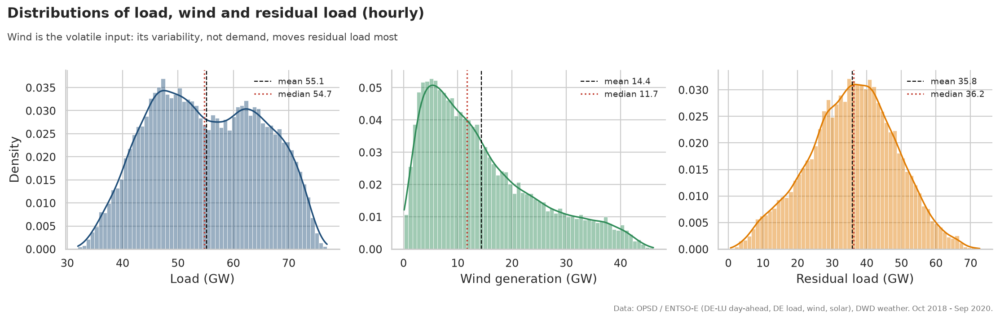
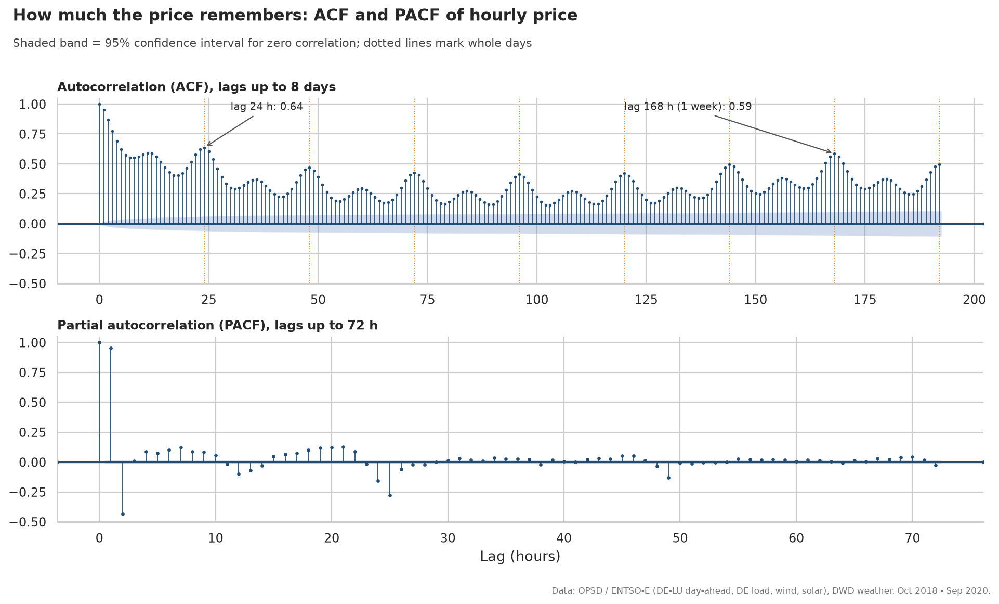
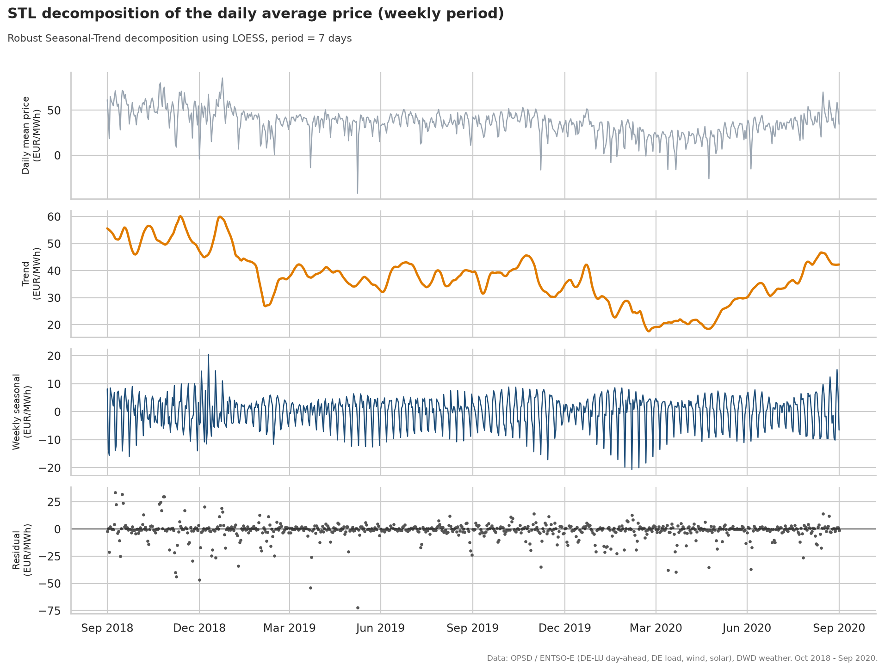
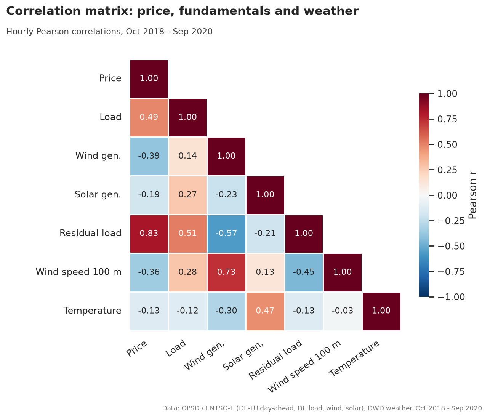

# Chart takeaways

Generated by `python -m energy_eda report`.

## 01_price_timeseries

The average day-ahead price fell from 41.7 EUR/MWh (Oct 2018-Sep 2019) to 29.9 EUR/MWh (Oct 2019-Sep 2020), a 28% drop, with the 30-day mean bottoming at 16.0 EUR/MWh around 03 May 2020.

## 02_seasonality_heatmap

Prices follow the working week: the highest average is 52.7 EUR/MWh on Thu at 19:00, the lowest 14.3 EUR/MWh on Sun at 14:00 when demand is low and solar output peaks; Sundays average 25.2 vs 39.0 EUR/MWh on weekdays.

## 03_price_vs_wind_residual_load

Wind alone explains only 15% of price variance (r = -0.39), but residual load explains 68% (r = 0.83); each extra GW of residual load adds about 1.19 EUR/MWh.

## 04_merit_order_wind_deciles

The merit-order effect: in the windiest 10% of hours (30.7-46.1 GW) the mean price is 19.4 EUR/MWh vs 42.3 in the calmest 10%, 54% lower, and that decile holds 265 of the 484 negative-price hours.

## 05_negative_prices_by_month

484 hours had negative prices (195 in the first year, 289 in the second); the worst month was February 2020 with 84 hours, and 65% of all negative hours fell on weekends.

## 06_load_wind_distributions

Load stays inside a narrow band (31.9-76.9 GW, coefficient of variation 0.18) with two humps for nights/weekends and working hours, while wind is right-skewed (skew 0.90, median 11.7 vs mean 14.4 GW, CV 0.72) and runs from 3.3 to 30.7 GW between its 10th and 90th percentiles.

## 07_price_acf_pacf

Price is highly persistent: correlation with the previous hour is 0.95, it falls to 0.40 at 18 h, climbs back to 0.64 at 24 h and peaks again at 0.59 after one week, so yesterday's and last week's same hour are natural forecasting features.

## 08_stl_decomposition

STL splits the daily price into a trend that falls from 55.6 to a low of 17.5 EUR/MWh (Mar 2020), a weekly cycle worth -8.6 EUR/MWh on Sundays and +2.5 on weekdays, and a residual that still carries 34% of the variance (weather and fuel shocks).

## 09_correlation_matrix

Residual load is the single best linear correlate of price (r = 0.83), ahead of load (0.49) and wind (-0.39); the 4-station wind speed tracks national wind output at r = 0.73.
